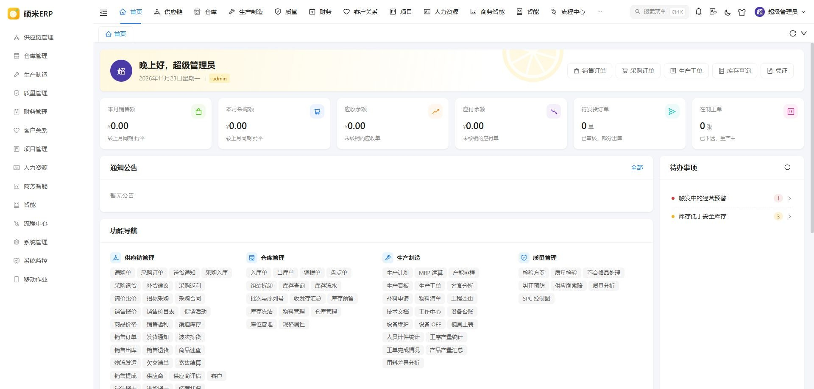
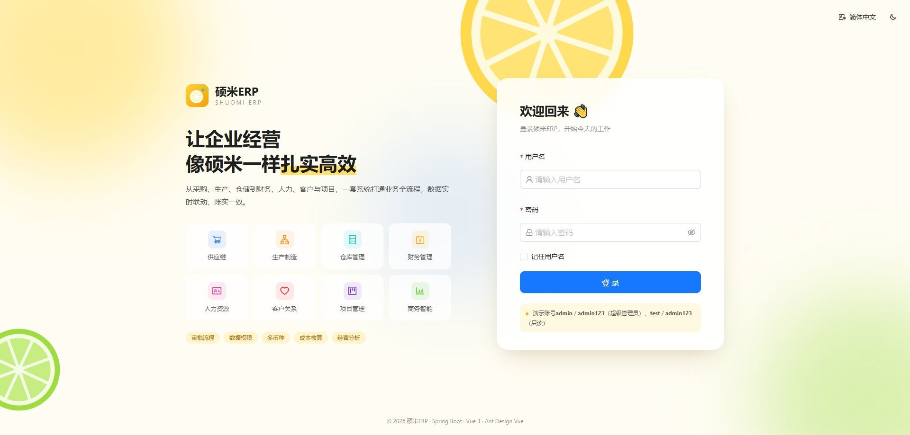
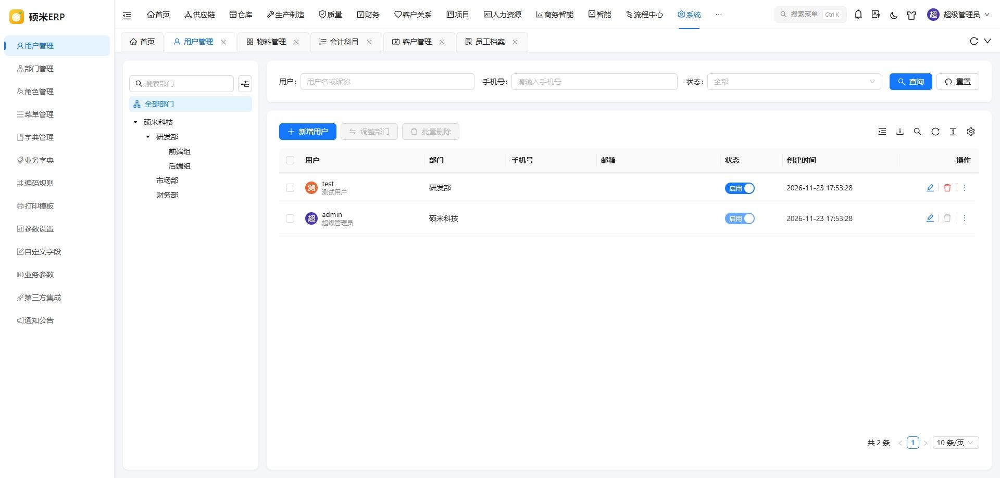
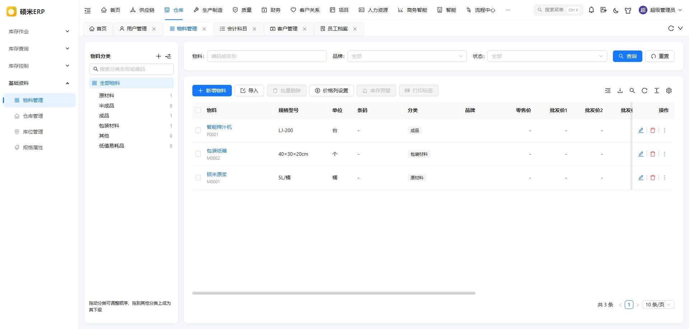
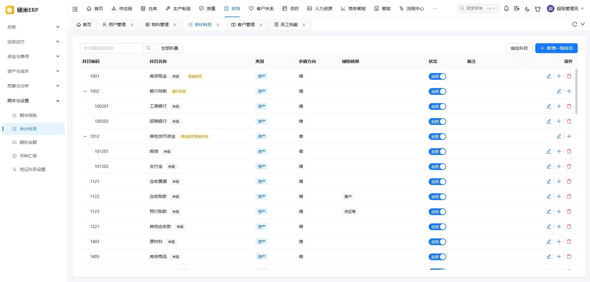
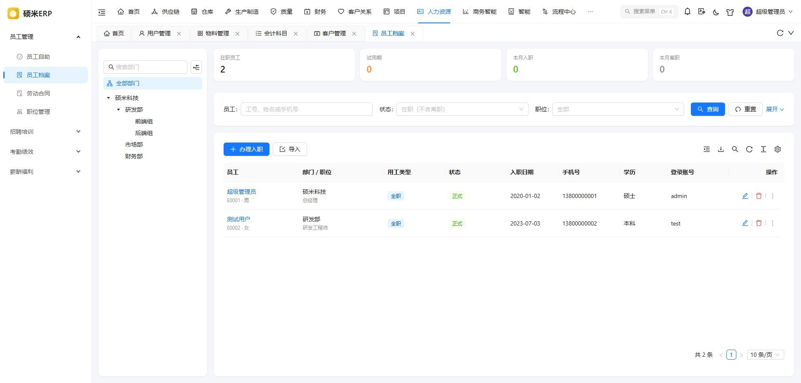

<!-- SHUOMI-ERP PRIVATE CUSTOMIZATION: Shuomi branding and deployment -->
<p align="center">
  
</p>

<h1 align="center">硕米ERP · Shuomi ERP</h1>

<p align="center">
  <b>硕米内部定制 ERP · 基于 Lemon ERP 二次开发</b><br />
  让企业经营像硕米一样扎实高效：进销存、生产、仓储、质量、财务、人力、客户、项目、商务智能与 AI，一套系统全部打通
</p>

<p align="center">
  基于 <a href="https://github.com/MakeSomeFakeNews/lemon-erp">Lemon ERP</a> 开源项目（Apache-2.0）二次开发
</p>

<p align="center">
  <a href="https://github.com/hhhh-wang/lemon-erp/actions/workflows/ci.yml"></a>
  <a href="https://github.com/MakeSomeFakeNews/lemon-erp/stargazers"></a>
  
  
  
  
  
  
</p>

<p align="center">
  <a href="#快速开始"><b>快速开始</b></a> ·
  <a href="https://makesomefakenews.github.io/lemon-erp-website/manual/guide/"><b>上游用户手册</b></a> ·
  <a href="https://makesomefakenews.github.io/lemon-erp-website/dev/start/"><b>上游开发文档</b></a> ·
  <a href="#english"><b>English</b></a>
</p>

<p align="center">
  
</p>

## 项目简介

硕米ERP（Shuomi ERP）是基于 Lemon ERP（Apache-2.0）的内部定制 ERP，面向中小制造与商贸企业，前后端分离。本仓库维护硕米的品牌、部署配置和业务二开，继续保留上游归属及许可证。

- **业务全覆盖**：14 大模块、171 个功能页面，从请购到收款、从 BOM 到完工入库、从凭证到报表，一套系统闭环
- **单据自动联动**：出入库自动更新库存、生成应收应付，业务单据一键生成会计凭证，账实一致
- **多端使用**：电脑浏览器、微信小程序、手机 / PDA 扫码作业、数据大屏投屏，支持中英文界面
- **技术栈新**：Spring Boot 4 + Vue 3 + Ant Design Vue 4，Gradle 多模块、单向依赖，代码结构清晰
- **二开归属清晰**：上游来自 Lemon ERP，硕米内部定制使用 `SHUOMI-ERP PRIVATE CUSTOMIZATION` 标记，具体范围见[私有二开记录](docs/private-customizations.md)

> “私有二开”是内部定制范围标记。当前 GitHub 仓库仍是公开的 `hhhh-wang/lemon-erp` fork，目标名称为 `shuomi-erp`；该标记不会改变 GitHub 可见性。生产凭据与实际运维记录使用忽略文件保存。

## 部署与二开维护

- [本地部署、镜像导出与生产更新](docs/production-deployment.md)
- [生产部署验收记录](docs/production-status.md)
- [私有二开范围与兼容标识](docs/private-customizations.md)
- [上游同步、分支与发布规范](docs/upstream-sync.md)

## 演示账号

本地启动后访问 **http://localhost**，使用以下账号登录（是否只读取决于 `LEMON_DEMO_ENABLED`）：

| 租户 | 账号 | 密码 | 说明 |
| --- | --- | --- | --- |
| 硕米科技 | admin | admin123 | 超级管理员，可以浏览全部功能 |
| 硕米科技 | test | admin123 | 普通用户（只读），数据权限为「本部门及以下」 |

## 为什么选择硕米ERP

上游 Lemon ERP 提供完整的 ERP 功能与 Apache-2.0 授权。硕米版本按内部部署和业务需求维护，下列能力来自上游基础及本仓库二开。

### 核心优势

1. **成本可控**：基于 Apache-2.0 上游，按内部业务需求实施、部署和维护
2. **一套系统管全业务**：采购、销售、仓储、生产、质量、财务、人力、客户、项目、BI 都在一个系统里，不用买多套软件再做接口集成，数据天然一致
3. **业财一体，账实相符**：出入库自动更新库存、生成应收应付，业务单据一键生成凭证；生产领料、完工入库自动进入成本核算，月末结账一键完成
4. **贴合国内企业**：小企业会计准则的资产负债表、利润表、现金流量表，数电票导入勾稽，个税累计预扣与专项附加扣除、社保公积金，钉钉 / 企业微信 / 飞书、微信小程序，DeepSeek、通义千问等国产大模型
5. **数据自主可控**：部署在自己的服务器或内网，源码可以审计和定制，数据与运行环境由自己管理
6. **拿来就能用**：Docker 一条命令启动；内置示例基础资料、按行业模板开通功能、期初启用向导；中英文界面；250 多页用户手册覆盖每个页面的操作
7. **容易二次开发**：Spring Boot 4 + Vue 3 主流技术栈，Gradle 多模块、依赖单向，单据审批、状态流转、数据权限、明细行等都有公共组件；新增模块、接入审批、扩展 AI 能力都有完整的开发文档和示例
8. **多端协同**：电脑浏览器处理全部业务，微信小程序审批和外勤，手机 / PDA 扫码收发货和盘点，数据大屏投屏到车间和仓库
9. **安全可靠**：菜单 / 按钮 / 接口三级权限和五种数据权限，操作日志与登录日志，会话可强制下线，登录验证码与密码策略，审批流程留痕
10. **可以做成 SaaS**：内置多租户、租户套餐和行业模板，软件服务商可以直接用它为多家客户提供在线 ERP 服务

### 适合谁使用

| 用户 | 能得到什么 |
| --- | --- |
| **中小制造企业** | 从销售订单、MRP、生产工单、质量检验到成本核算的完整闭环，车间扫码报工、数据大屏 |
| **商贸、批发零售企业** | 采购、销售、库存、多价格体系、客户价格等级、进销存报表、应收应付与资金管理 |
| **项目型、服务型企业** | 项目计划与工时、成本核算、客户关系与服务工单、费用报销与审批 |
| **软件服务商、实施商** | 免授权费的 ERP 底座，可二次开发后交付客户，或用多租户做成 SaaS 服务 |
| **开发者、学生** | 一个完整的企业级 Java 项目：多模块架构、权限与多租户、工作流、AI 集成、Docker 部署，可以直接学习和参考 |

## 功能一览

<table>
  <tr><th width="120">模块</th><th>主要功能</th></tr>
  <tr><td><b>供应链</b></td><td>请购、询价比价、招标、采购合同、采购订单、送货通知、采购入库 / 退货；销售报价、价目表与商品多价格、客户价格等级与执行价（Excel 导入导出）、促销、返利、销售提成、销售订单、发货拣货、销售出库 / 退货、物流发运；入库出库可直接开单；订单、直接开单、报价可整单优惠 / 抹零；供应商 / 经销商门户</td></tr>
  <tr><td><b>进销存报表</b></td><td>销售报表、进货报表（多维汇总，汇总 → 明细 → 单据穿透）、经营状况、资产状况（可选截至日期）、商品分析（畅销、滞销、积压、缺货、周转）、客户 RFM 分群</td></tr>
  <tr><td><b>仓库</b></td><td>入库、出库、调拨、盘点、组装拆卸；实时库存成本（移动加权平均，生产完工按标准成本或工单实际料工费（报工工时 × 工作中心费率），提前关闭、完工后退料自动调整产品成本，库存均价与金额、经营历史）；批次与序列号追踪、库存预留与冻结、收发存汇总；多规格物料（SKU）、库位与上架策略；手机 / PDA 扫码作业</td></tr>
  <tr><td><b>生产制造</b></td><td>主生产计划、MRP 运算、产能排程、生产看板；工单、齐套分析、领料超领控制、补料、报工、完工入库；BOM 与工艺路线、工程变更、设备维护与 OEE、模具工装</td></tr>
  <tr><td><b>质量</b></td><td>检验方案（AQL 抽样）、来料 / 过程 / 成品 / 首件检验；不合格品 MRB、纠正预防（8D）、供应商索赔；合格率趋势、不良柏拉图、SPC 与 Cp / Cpk</td></tr>
  <tr><td><b>财务</b></td><td>凭证、账簿、资产负债表 / 利润表 / 现金流量表（小企业会计准则）、期末结账；应收应付与核销（自动核销、折让抹零、多收转预收、冲账单、坏账，支持外币）、账龄、数电票、往来对账、供应商 / 客户对账单（门户确认）；出纳、费用报销、票据、资金计划；固定资产、成本核算、标准成本、预算</td></tr>
  <tr><td><b>客户关系</b></td><td>客户公海、线索、商机看板、跟进记录、合同、服务工单、市场活动、客户分析</td></tr>
  <tr><td><b>项目管理</b></td><td>WBS 计划与甘特图、资源负荷、工时填报审批、成本控制、项目核算与挣值分析</td></tr>
  <tr><td><b>人力资源</b></td><td>员工档案与异动、劳动合同、招聘培训、考勤打卡、请假加班、绩效考核、薪酬核算（社保、个税、计件、提成）、员工自助</td></tr>
  <tr><td><b>商务智能</b></td><td>经营驾驶舱、多维分析、自定义报表与仪表盘、决策支持与预警、数据大屏（可投屏到电视）</td></tr>
  <tr><td><b>智能（AI）</b></td><td>接入 DeepSeek、通义千问、智谱 GLM、Kimi、豆包等大模型：AI 问数、智能录入（识别图片 / 文件生成单据）、数据整理、智能报告</td></tr>
  <tr><td><b>流程中心</b></td><td>仿钉钉流程设计器（条件分支、并行分支、会签 / 或签），业务单据一键接入审批</td></tr>
  <tr><td><b>系统平台</b></td><td>用户、部门、角色、菜单 / 按钮 / 数据权限；SaaS 多租户与行业模板；编码规则、打印模板（PDF、套打）、业务参数、自定义字段；钉钉 / 企业微信 / 飞书集成；中英文切换；系统监控与定时任务</td></tr>
</table>

每个功能的详细说明见 [上游用户手册（Lemon ERP）](https://makesomefakenews.github.io/lemon-erp-website/manual/guide/)。

## 系统截图

> 以下截图来自当前运行中的硕米ERP 实例，使用初始化基础资料；交易类数据需按业务流程录入或导入。

<table>
  <tr>
    <td width="50%"><br />登录页</td>
    <td width="50%"><br />用户与部门</td>
  </tr>
  <tr>
    <td><br />物料管理</td>
    <td><br />会计科目</td>
  </tr>
  <tr>
    <td colspan="2"><br />员工档案</td>
  </tr>
</table>

<!-- 上游项目历史截图，保留源码但不参与页面渲染

**采购订单详情**


**MRP 运算**


**财务报表（资产负债表）**


**项目计划（甘特图）**


**经营驾驶舱**


**流程设计器**


**数据大屏（生产车间）**


**微信小程序**


<details>
<summary><b>更多截图：登录与首页、供应链、仓库</b></summary>

<table>
  <tr>
    <td width="50%"><br />登录页</td>
    <td width="50%"><br />工作台（深色模式）</td>
  </tr>
  <tr>
    <td><br />采购订单</td>
    <td><br />销售订单详情</td>
  </tr>
  <tr>
    <td><br />供应商评估</td>
    <td><br />库存查询</td>
  </tr>
  <tr>
    <td><br />批次与序列号追踪</td>
    <td><br />物料管理</td>
  </tr>
  <tr>
    <td><br />库位管理</td>
    <td><br />手机 / PDA 移动作业</td>
  </tr>
</table>

</details>

<details>
<summary><b>更多截图：生产、质量</b></summary>

<table>
  <tr>
    <td width="50%"><br />生产计划</td>
    <td width="50%"><br />产能排程</td>
  </tr>
  <tr>
    <td><br />齐套分析</td>
    <td><br />生产工单详情</td>
  </tr>
  <tr>
    <td><br />物料清单（BOM）</td>
    <td><br />质量检验</td>
  </tr>
  <tr>
    <td><br />不合格品处理</td>
    <td><br />SPC 控制图</td>
  </tr>
  <tr>
    <td><br />质量分析</td>
    <td><br />数据大屏（质量管理）</td>
  </tr>
</table>

</details>

<details>
<summary><b>更多截图：财务</b></summary>

<table>
  <tr>
    <td width="50%"><br />凭证管理</td>
    <td width="50%"><br />记账凭证</td>
  </tr>
  <tr>
    <td><br />科目余额表</td>
    <td><br />应收管理</td>
  </tr>
  <tr>
    <td><br />固定资产</td>
    <td><br />成本核算</td>
  </tr>
  <tr>
    <td><br />预算管理</td>
    <td><br />经营分析</td>
  </tr>
</table>

</details>

<details>
<summary><b>更多截图：客户关系、项目、人力资源</b></summary>

<table>
  <tr>
    <td width="50%"><br />销售机会看板</td>
    <td width="50%"><br />客户分析</td>
  </tr>
  <tr>
    <td><br />客户管理</td>
    <td><br />服务工单</td>
  </tr>
  <tr>
    <td><br />项目列表</td>
    <td><br />资源分配</td>
  </tr>
  <tr>
    <td><br />项目核算</td>
    <td><br />员工档案</td>
  </tr>
  <tr>
    <td><br />考勤管理</td>
    <td><br />薪酬核算</td>
  </tr>
  <tr>
    <td><br />绩效考核</td>
    <td><br />招聘管理</td>
  </tr>
</table>

</details>

<details>
<summary><b>更多截图：商务智能、数据大屏、流程与系统</b></summary>

<table>
  <tr>
    <td width="50%"><br />多维分析</td>
    <td width="50%"><br />自定义仪表盘</td>
  </tr>
  <tr>
    <td><br />数据大屏（仓储物流）</td>
    <td><br />数据大屏（销售经营）</td>
  </tr>
  <tr>
    <td><br />流程实例</td>
    <td><br />打印模板设计</td>
  </tr>
  <tr>
    <td><br />用户管理</td>
    <td><br />角色管理</td>
  </tr>
  <tr>
    <td><br />部门管理</td>
    <td><br />服务监控</td>
  </tr>
  <tr>
    <td><br />缓存监控</td>
    <td><br />定时任务</td>
  </tr>
</table>

</details>

-->

## 系统架构

**业务架构**：蓝色虚线是模块内的业务流程，灰色虚线是跨模块的自动联动（生成下游单据、更新库存、生成应收应付与凭证）。


**技术架构**


## 快速开始

### 方式一：Docker 一键部署（推荐）

安装了 Docker（含 Compose v2）时，一条命令启动 MySQL、Redis、后端和前端：

```bash
cd docker
cp .env.example .env        # 修改其中的密码和 JWT_SECRET
docker compose up -d --build
```

启动完成后访问 http://localhost（端口见 `.env` 中的 `WEB_PORT`）。构建、推送镜像使用 `./docker/build.sh`，上游部署说明见 [Docker 部署](https://makesomefakenews.github.io/lemon-erp-website/dev/deploy/docker)。

不想在服务器上编译时，可以直接使用 [GitHub Packages](https://github.com/MakeSomeFakeNews?tab=packages&repo_name=lemon-erp) 中已构建好的镜像（支持 x86 和 ARM）：从 [Releases](https://github.com/MakeSomeFakeNews/lemon-erp/releases/latest) 下载 `lemon-erp-docker-<版本>.zip`，解压后：

```bash
cd docker
cp .env.example .env        # 已填好镜像地址 ghcr.io/makesomefakenews/lemon-erp，修改密码和 JWT_SECRET 即可
docker compose up -d
```

Releases 中还提供后端 jar、前端静态文件和 `init.sql`，可用于不使用 Docker 的传统部署。

已经部署的系统升级到新版本时，备份数据库后执行 [sql/upgrade](sql/upgrade) 中部署之后新增的升级脚本（可重复执行），步骤见其中的 README。

### 方式二：源码运行

```bash
# 1. 初始化数据库（会删除并重建全部表）
mysql -uroot -p -e "CREATE DATABASE lemon_erp DEFAULT CHARSET utf8mb4"
mysql -uroot -p lemon_erp < sql/init.sql

# 2. 启动后端（项目根目录执行，默认连接本机 MySQL root / root 和本机 Redis，
#    可用环境变量 DB_URL、DB_USERNAME、DB_PASSWORD、REDIS_HOST、REDIS_PORT、REDIS_PASSWORD 覆盖）
DB_PASSWORD=你的密码 ./gradlew bootRun

# 3. 启动前端，访问 http://localhost:5173（/api 自动代理到 http://localhost:8080）
cd lemon-web && npm install && npm run dev
```

<details>
<summary>打包部署与 Nginx 参考配置</summary>

```bash
./gradlew build                     # 生成 lemon-admin/build/libs/lemon-erp.jar
cd lemon-web && npm run build       # 生成 lemon-web/dist，交给 Nginx 托管

# 生产环境配置全部取环境变量，JWT_SECRET 至少 32 字节
java -jar lemon-erp.jar --spring.profiles.active=prod
```

```nginx
location / {
    root /path/to/lemon-web/dist;
    try_files $uri $uri/ /index.html;
}
location /api/ {
    proxy_pass http://127.0.0.1:8080;
    proxy_set_header Host $host;
    proxy_set_header X-Forwarded-For $proxy_add_x_forwarded_for;
    proxy_set_header X-Forwarded-Proto $scheme;
}
```

使用 AI 问数时还需要为 `/api/ai/` 关闭代理缓冲，上游说明见 [Nginx 配置](https://makesomefakenews.github.io/lemon-erp-website/dev/deploy/nginx)。

</details>

**默认账号**：`admin` / `admin123`（超级管理员）、`test` / `admin123`（只读用户）。新建用户默认初始密码为 `Shuomi@123`，存量账号不受影响。开启 SaaS 多租户（`LEMON_TENANT_ENABLED=true`）后登录需要填写租户「硕米科技」；设置 `LEMON_DEMO_ENABLED=true` 开启演示模式（只能查看，不能修改数据）。

## 技术栈

| 分类 | 技术 | 环境要求 |
| --- | --- | --- |
| 后端 | Java 17、Spring Boot 4.1、Spring Security + JWT、MyBatis-Plus 3.5、Flowable 8、JasperReports 7 | JDK 17 |
| 数据与缓存 | MySQL、Redis（可切换为内存缓存） | MySQL 8.0+、Redis 6.2+ |
| 前端 | Vue 3.5、Vite 7、Ant Design Vue 4.2、Pinia、Vue Router、ECharts 5、vue-i18n | Node 20+ |
| 小程序 | uni-app（Vue 3），微信小程序 | 微信开发者工具 |
| 构建部署 | Gradle 多模块、Docker / Docker Compose、Nginx | Docker 20.10+、Nginx 1.20+ |

## 项目结构

```
lemon-erp
├── lemon-common        通用层：统一返回、异常、基础实体、工具类
├── lemon-framework     框架层：安全、数据权限、多租户、缓存、日志、模块间契约接口
├── lemon-modules       业务模块
│   ├── lemon-system    系统管理        ├── lemon-fin   财务管理
│   ├── lemon-monitor   系统监控        ├── lemon-hr    人力资源
│   ├── lemon-workflow  流程中心        ├── lemon-crm   客户关系
│   ├── lemon-dashboard 工作台          ├── lemon-pm    项目管理
│   ├── lemon-wms       仓库管理        ├── lemon-bi    商务智能、进销存报表
│   ├── lemon-scm       供应链管理      └── lemon-ai    智能（AI）
│   └── lemon-mes       生产制造 + 质量管理
├── lemon-admin         启动模块：组装全部业务模块，打包为可执行 jar
├── lemon-web           前端（Vite + Vue 3 + Ant Design Vue）
├── lemon-mp            微信小程序（uni-app + Vue 3）
├── sql/init.sql        建表与初始数据
├── docker              Dockerfile、docker-compose 与镜像构建脚本
└── docs                开发说明、架构图与截图
```

## 上游项目

本项目基于 [Lemon ERP](https://github.com/MakeSomeFakeNews/lemon-erp) 二次开发，遵循 Apache-2.0 协议，保留原项目的版权声明与许可证。上游问题可在 [Lemon ERP Issues](https://github.com/MakeSomeFakeNews/lemon-erp/issues) 中反馈。

分支模型、官方代码同步、冲突处理和发布流程见 [上游同步与二开分支规范](docs/upstream-sync.md)。

## 真正 100% 开源

硕米ERP 不是「开源版 + 商业版」的模式，演示环境和文档中看到的全部功能，都在本仓库中完整开源：

- **全部功能开源**：供应链、仓储、生产、质量、财务、人力、客户、项目、商务智能、AI，没有任何模块收费或闭源
- **没有功能限制**：没有授权码和激活，系统本身不限制用户数、租户数和单据量，也没有隐藏的高级功能
- **免费商用**：遵守 [Apache-2.0](LICENSE) 协议，个人与企业都可以免费使用、修改、二次开发和商业部署，使用时保留原作者版权声明与许可证文件即可
- **保留上游归属**：本项目基于 Lemon ERP 开源项目二次开发，原始版权与 Apache-2.0 许可证保持不变
- **文档同样开放**：本仓库包含开发文档与 Docker 部署脚本；上游 250 多页 [用户手册](https://makesomefakenews.github.io/lemon-erp-website/manual/guide/) 和 [开发文档](https://makesomefakenews.github.io/lemon-erp-website/dev/start/) 也公开

如果觉得硕米ERP 不错，请点一个 **Star**，也欢迎推荐给身边做生意、办工厂、做软件的朋友。

## English

**Shuomi ERP** is an internal customization of **Lemon ERP** (Apache-2.0), for small and medium-sized manufacturers and distributors, built with **Spring Boot 4 + Vue 3 + Ant Design Vue 4**. It covers purchasing, sales, inventory and warehouse management (**WMS**), manufacturing execution (**MES**: BOM, MRP, work orders, shop-floor reporting), quality management (**QMS**), accounting and finance, **CRM**, human resources (**HRM**, payroll, attendance), project management, business intelligence (**BI**) and **AI** assistants. Documents flow between modules automatically: stock movements update inventory and generate receivables/payables, and business documents generate accounting vouchers.

- Visual approval workflow (Flowable), SaaS multi-tenancy, menu / button / API permissions and department-level data permissions
- AI assistants with DeepSeek, Qwen, GLM, Kimi or Doubao: natural-language data queries, document recognition, data cleansing and business reports
- WeChat mini program, mobile / PDA barcode scanning, data screens, DingTalk / WeCom / Feishu login and notifications
- Chinese and English UI, demo mode, Docker one-click deployment
- `SHUOMI-ERP PRIVATE CUSTOMIZATION` identifies Shuomi changes; upstream attribution and the Apache-2.0 license remain in place
- The current GitHub repository is a public fork, pending rename to `shuomi-erp`; the customization marker does not change repository visibility

Upstream project: https://github.com/MakeSomeFakeNews/lemon-erp · Upstream documentation: https://makesomefakenews.github.io/lemon-erp-website/

---

<p align="center">Apache License 2.0 · 硕米ERP（基于 Lemon ERP 开源项目二次开发）</p>
